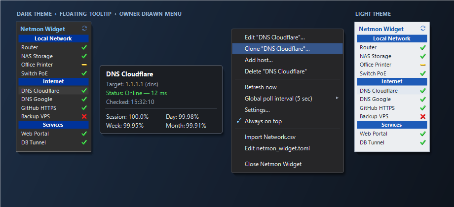
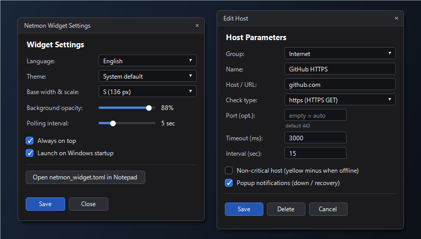

# NetMon Widget

> [English](README.md) | [Русский](README.ru.md) | **Hrvatski**

Lagan desktop widget za nadzor mreže na sustavu Windows, nadahnut klasičnim **Network Monitor Gadgetom** (Windows 7) autora Sama Tuckera. Izrađen u Rustu pomoću `eframe` / `egui` i nativnog Win32 API-ja (ikona u sustavnoj traci, skočne obavijesti, plutajući opis, nativni tamni/svijetli kontekstni izbornik).



## Mogućnosti

- **5 vrsta senzora:**
  - `ping` — nativni ICMP Echo putem Win32 `IcmpSendEcho` (bez pokretanja vanjskih procesa)
  - `tcp` — provjera TCP povezivanja na port (zadani port `80`)
  - `http` / `https` — HTTP/HTTPS GET (očekuje `2xx`/`3xx`, zadani portovi `80`/`443`; opcionalna provjera točnog koda `expect_status` i teksta `expect_text`)
  - `dns` — izravan UDP DNS upit prema DNS poslužitelju ili razrješavanje domene (zadani port `53`)
- **Nekritični čvorovi (`optional`):**
  - Koristite vrste `*_optional` (`ping_optional`, `tcp_optional`, `http_optional`, `https_optional`, `dns_optional`) ili `optional = true`.
  - Kada nisu dostupni, prikazuju **žuti minus** umjesto crvenog križića i **ne označavaju** ikonu u trayu kao grešku (idealno za pisače, prijenosna računala itd.).
- **Otpornost na kratke prekide i upozorenje na kašnjenje:**
  - `fail_threshold` — broj uzastopnih neuspjeha prije označavanja čvora nedostupnim i slanja obavijesti.
  - `warn_ms` — prag kašnjenja (ms) iznad kojeg se uspješna provjera označava žutim upozorenjem.
  - Opcionalni kompaktni prikaz kašnjenja (`ms`) izravno u popisu čvorova.
- **Teme izgleda (`System` / `Dark` / `Light`):**
  - Zadano prati Windows temu (`AppsUseLightTheme`).
  - Dosljedno se primjenjuje na glavni widget, prozore postavki i uređivanja, plutajući opis i nativni kontekstni izbornik.
- **Plutajući opis i povijest dostupnosti:**
  - Prikazuje se u zasebnom Win32 prozoru pa ga uska širina widgeta nikad ne odsijeca.
  - Prikazuje cilj, trenutno stanje, kašnjenje (ms), vrijeme provjere te postotak dostupnosti za **Sesiju**, **Dan**, **Tjedan** i **Mjesec** (sprema se u `netmon_history.dat`).
- **Skočne obavijesti i način "Ne uznemiravaj":**
  - Zadano isključeno (`notify = false`). Kad je uključeno, šalje Windows obavijesti u trayu pri padu i oporavku čvora.
  - Brzo utišavanje obavijesti na **15 min**, **1 sat** ili **do isključivanja**, kao i **Pauza provjera**.
- **Brzo uređivanje i dijagnostika:**
  - Dvoklik na bilo koji čvor otvara uređivanje.
  - Kontekstni izbornik: **Uredi**, **Kloniraj...**, **Kopiraj adresu**, **Otvori u pregledniku**, **Dijagnostika (`ping -t` / `tracert`)**, **Dodaj čvor / grupu**, **Osvježi sada**, **Opći interval provjere**, **Uvijek na vrhu**.
  - Sklopive grupe (`collapsed`) klikom na zaglavlje grupe sa sažetim indikatorom stanja.
  - Povlačenje i ispuštanje (drag-and-drop) za promjenu redoslijeda čvorova i grupa u stvarnom vremenu.
  - Izbornik ikone u trayu, gumbi **Minimiziraj u tray** (`—`) / **Zatvori** (`×`) i opcija **Sakrij s programske trake**.
- **Prilagodljivi intervali i prijenosnost:**
  - Vlastiti `interval_sec` po čvoru.
  - Unaprijed definirane veličine (`XS`/`S`/`M`/`L`/`XL`), slobodna promjena veličine mišem s bilo kojeg ruba ili kuta i klizač prozirnosti pozadine.
  - Praćenje položaja po monitoru s magnetskim lijepljenjem uz rubove zaslona i automatskim vraćanjem nakon ponovnog spajanja monitora.
  - **Pozadinsko automatsko ažuriranje (tjedno):** provjerava GitHub Releases, preuzima `netmon_widget.exe` u pozadini i primjenjuje ga pri ponovnom pokretanju.
  - **Višejezično sučelje:** hrvatski (`Hrvatski`), engleski (`English`) i ruski (`Русский`).
  - **Pokretanje sa sustavom Windows** (`HKCU\...\Run` vezan uz putanju izvršne datoteke), što omogućuje pokretanje više neovisnih instanci iz zasebnih mapa.
  - Automatsko ponovno učitavanje `netmon_widget.toml` pri vanjskom uređivanju te uvoz/izvoz `Network.csv` (uključujući kodiranje Windows-1251).



## Početak rada

### Opcija 1: Gotova binarna datoteka

1. Preuzmite `netmon_widget.exe` sa stranice [Releases](https://github.com/pnr36p/netmon_widget/releases).
2. Smjestite `netmon_widget.exe` u zasebnu mapu i pokrenite ga.
   - Pri prvom pokretanju automatski stvara početni `netmon_widget.toml` (ili učitava `netmon_widget.example.toml` / `Network.csv` ako se nalaze uz izvršnu datoteku).

### Opcija 2: Izgradnja iz izvornog koda

Zahtijeva Rust `1.85+` na sustavu Windows:

```powershell
git clone https://github.com/pnr36p/netmon_widget.git
cd netmon_widget
Copy-Item netmon_widget.example.toml netmon_widget.toml
cargo build --release
```

Izvršna datoteka nalazit će se na `target\release\netmon_widget.exe`.

Pokretanje jediničnih testova:

```powershell
cargo test
```

## Konfiguracija (`netmon_widget.toml`)

Konfiguracija se pohranjuje **uz `.exe`** i automatski se ponovno učitava pri promjenama. Pogledajte [`netmon_widget.example.toml`](netmon_widget.example.toml) za čisti početni predložak:

```toml
interval_sec = 5
opacity = 0.88
always_on_top = true
language = "hr"      # "ru" | "en" | "hr"
theme = "system"     # "system" | "dark" | "light"
size = "xs"          # "xs" | "s" | "m" | "l" | "xl"

[[sections]]
name = "Lokalna mreža"

[[sections.checks]]
name = "Usmjerivač"
host = "192.168.1.1"
type = "ping"
timeout_ms = 1500
notify = true        # neobvezno: skočne obavijesti pri promjeni stanja (zadano false)

[[sections.checks]]
name = "Mrežni pisač"
host = "192.168.1.50"
type = "ping_optional"

[[sections]]
name = "Internet"

[[sections.checks]]
name = "DNS Cloudflare"
host = "1.1.1.1"
type = "dns"         # zadani port: 53

[[sections.checks]]
name = "GitHub HTTPS"
host = "github.com"
type = "https"       # zadani port: 443
interval_sec = 15    # neobvezno: vlastiti interval provjere (sek)
```

> **Napomena o privatnosti:** `netmon_widget.toml`, `Network.csv` i `netmon_history.dat` isključeni su putem [`.gitignore`](.gitignore) kako osobni hostovi i IP adrese nikad ne bi bili poslani u repozitorij.

## Licenca

Objavljeno pod [MIT licencom](LICENSE).
