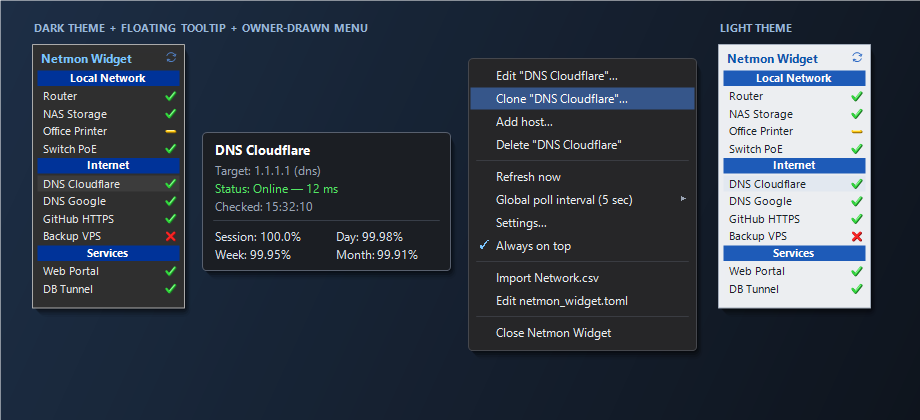
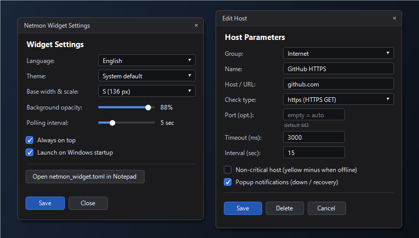

# NetMon Widget

> **English** | [Русский](README.ru.md)

A lightweight desktop network monitoring widget for Windows inspired by the classic Windows 7 **Network Monitor Gadget** by Sam Tucker. Built in Rust using `eframe` / `egui` and native Win32 APIs (system tray, balloon notifications, floating tooltip, owner-drawn dark/light context menu).



## Features

- **5 sensor types:**
  - `ping` — native ICMP Echo via Win32 `IcmpSendEcho` (no external processes)
  - `tcp` — TCP port connect check (default port `80`)
  - `http` / `https` — HTTP/HTTPS GET expecting `2xx`/`3xx` (default ports `80`/`443`)
  - `dns` — live UDP DNS query to a DNS server IP or domain resolution (default port `53`)
- **Non-critical hosts (`optional`):**
  - Use `*_optional` types (`ping_optional`, `tcp_optional`, `http_optional`, `https_optional`, `dns_optional`) or `optional = true`.
  - Displays a **yellow minus** instead of a red cross when offline and does **not** mark the system tray icon as failing (ideal for printers, laptops, etc.).
- **System / Dark / Light themes:**
  - Follows Windows light/dark personalization (`AppsUseLightTheme`) by default.
  - Applies consistently across the main widget, Settings/Edit dialogs, floating tooltip, and owner-drawn Win32 popup menus.
- **Floating tooltip & uptime history:**
  - Rendered in an independent Win32 popup window so it is never clipped by narrow widget widths.
  - Displays target, current status, latency (ms), last check time, plus **Session**, **Day**, **Week**, and **Month** uptime percentages (persisted in `netmon_history.dat`).
- **Per-host popup notifications (opt-in):**
  - Disabled by default (`notify = false`). When enabled, sends Windows tray balloon notifications on status transitions (host down / back online).
- **Fast interactive editing:**
  - Double-click any host row to edit it.
  - Right-click context menu: **Edit**, **Clone...**, **Add host / group**, **Refresh now**, **Global poll interval** submenu, **Always on top**.
  - Live drag-and-drop reordering for both hosts and groups.
  - Tray icon menu on left/right click plus **Show tray icon only** mode (hides the desktop widget window).
- **Per-host polling intervals & portable multi-instance support:**
  - Optional per-host `interval_sec` overriding the global polling interval.
  - Size presets (`XS`/`S`/`M`/`L`/`XL`), free mouse width resizing, and background opacity slider.
  - Per-monitor position tracking with edge snapping and automatic restoration when a disconnected display returns.
  - **Launch on Windows startup** (`HKCU\...\Run` keyed by per-executable path hash), allowing multiple isolated instances to run side-by-side from separate folders.
  - Hot-reload support when editing `netmon_widget.toml` externally.
  - Legacy `Network.csv` import (including Windows-1251 encoding).



## Getting Started

### Option 1: Prebuilt binary

1. Download `netmon_widget.exe` from [Releases](https://github.com/pnr36p/netmon_widget/releases).
2. Place `netmon_widget.exe` in its own folder and run it.
   - On first launch it creates a starter `netmon_widget.toml` automatically (or loads `netmon_widget.example.toml` / `Network.csv` if present alongside the executable).

### Option 2: Build from source

Requires Rust `1.85+` on Windows:

```powershell
git clone https://github.com/pnr36p/netmon_widget.git
cd netmon_widget
Copy-Item netmon_widget.example.toml netmon_widget.toml
cargo build --release
```

The binary will be built at `target\release\netmon_widget.exe`.

Run the unit test suite:

```powershell
cargo test
```

## Configuration (`netmon_widget.toml`)

Configuration is stored **alongside the `.exe`** and automatically hot-reloaded on changes. See [`netmon_widget.example.toml`](netmon_widget.example.toml) for a clean starter template:

```toml
interval_sec = 5
opacity = 0.88
always_on_top = true
language = "en"      # "ru" | "en"
theme = "system"     # "system" | "dark" | "light"
size = "xs"          # "xs" | "s" | "m" | "l" | "xl"

[[sections]]
name = "Local Network"

[[sections.checks]]
name = "Router"
host = "192.168.1.1"
type = "ping"
timeout_ms = 1500
notify = true        # optional: popup notifications on status change (default false)

[[sections.checks]]
name = "Network Printer"
host = "192.168.1.50"
type = "ping_optional"

[[sections]]
name = "Internet"

[[sections.checks]]
name = "DNS Cloudflare"
host = "1.1.1.1"
type = "dns"         # default port: 53

[[sections.checks]]
name = "GitHub HTTPS"
host = "github.com"
type = "https"       # default port: 443
interval_sec = 15    # optional: custom poll interval (sec)
```

> **Privacy note:** `netmon_widget.toml`, `Network.csv`, and `netmon_history.dat` are excluded via [`.gitignore`](.gitignore) so personal hosts and IP addresses are never committed.

## License

Released under the [MIT License](LICENSE).
