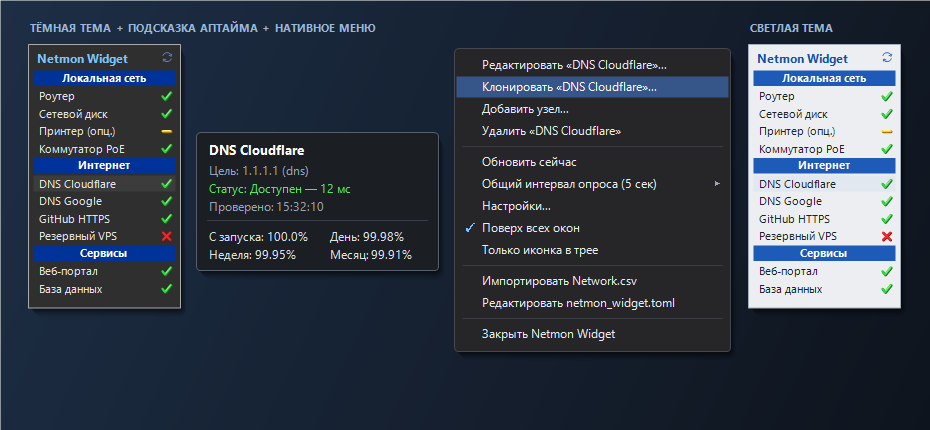
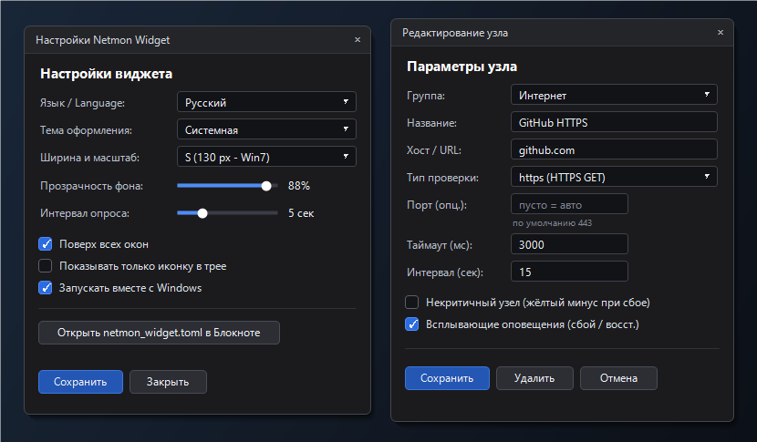

# NetMon Widget

> [English](README.md) | **Русский**

Компактный десктопный виджет мониторинга сети для Windows, вдохновлённый классическим **Network Monitor Gadget** (Windows 7) от Sam Tucker. Написан на Rust с использованием `eframe` / `egui` и нативного Win32 API (трей, всплывающие уведомления, плавающая подсказка, тёмное/светлое контекстное меню).



## Возможности

- **5 типов сенсоров:**
  - `ping` — ICMP Ping (через Win32 `IcmpSendEcho`, без запуска консольных утилит)
  - `tcp` — проверка TCP-подключения к порту (по умолчанию `80`)
  - `http` / `https` — HTTP/HTTPS GET (ожидает статус `2xx`/`3xx`, порты по умолчанию `80`/`443`)
  - `dns` — прямой UDP DNS-запрос к DNS-серверу по IP или резолв домена (по умолчанию порт `53`)
- **Некритичные узлы (`optional`):**
  - Типы `*_optional` (`ping_optional`, `tcp_optional`, `http_optional`, `https_optional`, `dns_optional`) или `optional = true`.
  - При недоступности показывают **жёлтый минус** вместо красного крестика и **не переводят** иконку в трее в состояние сбоя (удобно для принтеров, ноутбуков и т.п.).
- **Темы оформления (`System` / `Dark` / `Light`):**
  - По умолчанию следует теме Windows (`AppsUseLightTheme`).
  - Автоматически перекрашиваются виджет, диалоги настроек и редактирования, плавающая подсказка и нативное owner-drawn контекстное меню.
- **Плавающая подсказка и аптайм:**
  - Отображается отдельным Win32-окном за пределами виджета (не обрезается его шириной).
  - Показывает цель, текущий статус, задержку (мс), время проверки, а также статистику аптайма: **с запуска**, за **День**, **Неделю** и **Месяц** (хранится в `netmon_history.dat`).
- **Всплывающие оповещения Windows (опционально по каждому узлу):**
  - Выключены по умолчанию (`notify = false`). При включении отправляют уведомление из трея при смене статуса (переход в сбой / восстановление связи).
- **Удобное управление прямо из виджета:**
  - Двойной клик по строке узла открывает окно его редактирования.
  - Контекстное меню по правому клику: **Редактировать**, **Клонировать...**, **Добавить узел / группу**, **Обновить сейчас**, подменю **Общий интервал опроса**, **Поверх всех окон**.
  - Drag-and-drop перетаскивание узлов (внутри группы и между группами) и групп с мгновенным сохранением в `.toml`.
  - Меню системного трея по клику левой/правой кнопкой мыши, кнопки **Свернуть в трей** (`—`) и **Закрыть** (`×`) в шапке, а также опция **«Скрыть окно с панели задач»**.
- **Гибкое расписание и переносимость:**
  - Индивидуальный интервал опроса для каждого узла (`interval_sec`) с fallback на общий интервал.
  - Изменение размера (пресеты `XS`/`S`/`M`/`L`/`XL` + свободное растягивание мышью за любую границу или угол) и прозрачности фона.
  - Привязка к монитору с запоминанием позиции на экране, плавным магнитным прилипанием к краям (отключается в настройках) и автоматическим возвратом при повторном подключении монитора.
  - **Автообновление (как в Firefox):** включено по умолчанию (`auto_update = true`), раз в неделю тихо проверяет GitHub Releases, скачивает новую версию в фоне и применяет её при перезапуске.
  - **Локализация:** русский, английский (`English`) и хорватский (`Hrvatski`).
  - **Автозапуск вместе с Windows** (`HKCU\...\Run` с отдельным ключом для пути каждого `.exe`) — можно запускать **несколько независимых копий** из разных папок с разными `netmon_widget.toml`.
  - Горячая перезагрузка конфигурации при ручном редактировании `netmon_widget.toml`.
  - Импорт секций и хостов из оригинального `Network.csv` (включая кодировку Windows-1251).



## Установка и запуск

### Вариант 1: Готовый бинарный файл

1. Скачайте `netmon_widget.exe` со страницы [Releases](https://github.com/pnr36p/netmon_widget/releases).
2. Поместите `netmon_widget.exe` в отдельную папку и запустите.
   - При первом запуске программа автоматически создаст стартовый `netmon_widget.toml` (или подхватит `netmon_widget.example.toml` / `Network.csv`, если они лежат рядом).

### Вариант 2: Сборка из исходников

Требуется Rust (`1.85+`) на Windows:

```powershell
git clone https://github.com/pnr36p/netmon_widget.git
cd netmon_widget
Copy-Item netmon_widget.example.toml netmon_widget.toml
cargo build --release
```

Готовый файл появится в `target\release\netmon_widget.exe`.

Запуск модульных тестов:

```powershell
cargo test
```

## Конфигурация (`netmon_widget.toml`)

Файл конфигурации хранится **рядом с `.exe`** и автоматически перечитывается при изменении. Стартовый шаблон лежит в [`netmon_widget.example.toml`](netmon_widget.example.toml):

```toml
interval_sec = 5
opacity = 0.88
always_on_top = true
language = "ru"      # "ru" | "en" | "hr"
theme = "system"     # "system" | "dark" | "light"
size = "xs"          # "xs" | "s" | "m" | "l" | "xl"

[[sections]]
name = "Local Network"

[[sections.checks]]
name = "Router"
host = "192.168.1.1"
type = "ping"
timeout_ms = 1500
notify = true        # опционально: всплывающие оповещения (по умолч. false)

[[sections.checks]]
name = "Network Printer"
host = "192.168.1.50"
type = "ping_optional"

[[sections]]
name = "Internet"

[[sections.checks]]
name = "DNS Cloudflare"
host = "1.1.1.1"
type = "dns"         # порт по умолчанию: 53

[[sections.checks]]
name = "GitHub HTTPS"
host = "github.com"
type = "https"       # порт по умолчанию: 443
interval_sec = 15    # опционально: свой интервал опроса (сек)
```

> **Приватность:** файлы `netmon_widget.toml`, `Network.csv` и `netmon_history.dat` добавлены в [`.gitignore`](.gitignore), чтобы ваши личные хосты и IP-адреса не попали в репозиторий.

## Лицензия

Проект распространяется под лицензией [MIT](LICENSE).
